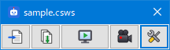
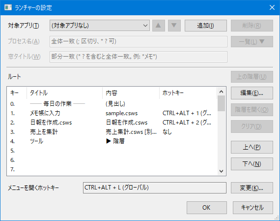
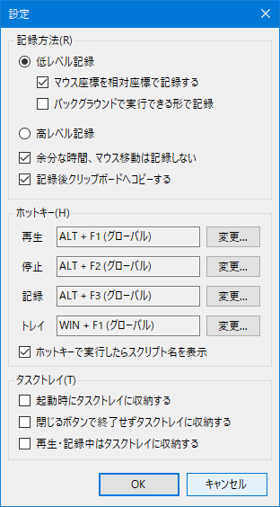
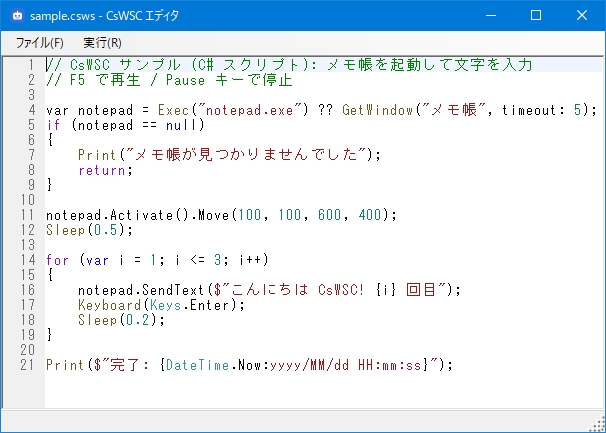

#  CsWSC — C# Window Script

UWSC のように Windows 操作を自動化する RPA ツール。  
スクリプトは **C#** で書きます。   (.NET 10 / Roslyn Scripting)。

## 入手と発行

[Releases](https://github.com/kttFox/CsWSC/releases) から zip を入手して展開します (.NET 10 デスクトップランタイムが必要です)。zip は 2 種類あります。

| zip | 内容 |
|---|---|
| `CsWSC-バージョン-win-x64.zip` | 通常版 |
| `CsWSC-バージョン-win-x64-ReadyToRun.zip` | ReadyToRun 版。サイズは約 2 倍だが、遅いマシンで起動とスクリプトのコンパイルが速い |

## 使い方

画面は UWSC と同じツールバー型です。



```
[読込み] [保存] [再生] [記録] [設定]
```

- **読込み / 保存**: スクリプト (`.csws`) の読込み・別名保存。
- **再生**: スクリプトを再生します。再生中は停止ボタンが表示され、停止ボタンと PRINT 窓は操作中の窓からフォーカスを奪わずに最前面に出ます。初回などコンパイルに時間がかかるときは「コンパイル中」の表示が出ます。
- **記録**: 押すと記録開始。STOPを押すか記録/停止ホットキー・Pause キーで終了。記録内容は保存前でも再生・編集できます。
- **設定**: 設定ダイアログ / スクリプトを編集・新規作成 / 最近使用したファイル / ランチャー / 常に手前に表示 / PRINT 窓 / タスクトレイに収納 / バージョン情報 / 終了。メイン画面を右クリックしても開きます。
- `Print()` の出力は PRINT 窓に表示。エラーはダイアログで表示し、エディタで該当行が選択されます。
- `Print()` の出力と実行の開始・終了は、`%LocalAppData%\CsWSC\Logs\yyyy-MM-dd.log` にも追記されます。各行は「時刻 [スクリプト名:プロセス ID]」で始まります。
- 再生すると (再生ボタン・ホットキー・ランチャー・コマンドライン)、操作してから実行が始まるまでの各段階の経過時間 (ms) を `%LocalAppData%\CsWSC\Logs\launch.log` に 1 行ずつ追記します (日が変わると前の日の分は消えます)。起動が遅いときの原因調べに使えます。
- `CsWSC.exe script.csws` で、メイン画面を停止ボタンの状態で表示して実行し、終わると終了します (タスクスケジューラなどから使えます)。ライブラリ (`.cswsl`) を渡したときは、実行できない旨を警告して終了します。

### ランチャー



よく使うスクリプトを登録しておき、メニューやホットキーからすぐ再生する機能です。  
UWSC と同じく 0〜9・A〜Z の 36 枠があります。

- 枠には、スクリプトファイル・見出し (タイトルだけ)・階層 (サブメニュー) を割り当てられます。階層は「階層を開く」で中の 36 枠を設定し、「上の階層」で戻ります。
- 「メニューを開くホットキー」で、カーソル位置にランチャーのメニューを開けます。
- 枠ごとに「別プロセスで実行」を選ぶと、再生中でも並行して起動します。ホットキーからは、同じスクリプトが別プロセスで動いている間は多重起動せず、「× 名前 (実行中)」と表示します。

**アプリごとに切り替える (対象アプリ)**

「対象アプリ」の「追加」で、プロセス名や窓タイトルを条件に別の 36 枠を作れます。その枠は、条件に合うアプリが前面にあるときだけ、そのホットキーか対象アプリ用の「メニューを開くホットキー」で使えます (設定メニューの「ランチャー」には出ません)。

| 条件 | 一致のしかた | 例 |
|---|---|---|
| プロセス名 | 全体一致。`;` 区切りで複数書け、どれかに合えばよい。`*` `?` も使える | `notepad.exe; excel.exe` |
| 窓タイトル | 部分一致。`*` `?` を含むときはタイトル全体と比べる | `メモ帳`、`*.txt - メモ帳` |

- ワイルドカード: `*` は 0 文字以上の任意の文字列、`?` は任意の 1 文字です。
- 大文字・小文字は区別しません。

### 設定ダイアログ



- **記録方法**: 低レベル記録 (相対座標 / バックグラウンド実行形式) / 高レベル記録 / 余分な時間・マウス移動を省く / 記録後クリップボードへコピー ([詳細](docs/Recording.md))
- **ホットキー**: 再生 / 停止 / 記録 / トレイ格納
  - 「変更...」で「ホットキーの設定」を開き、次の 3 つから選びます。  
  設定欄には「(グローバル)」「(フック)」が付いて表示されます。
  - **グローバルホットキー (RegisterHotKey)**: CTRL/ALT/SHIFT/WIN とキーを一覧から選びます。  
  キーは CsWSC だけが受け取り、前面のアプリには届きません。
  - **低レベルキーボードフック (WH_KEYBOARD_LL)**: 割り当てたいキーかマウスのサイドボタンを実際に押して設定します (`Esc` で「なし」)。  
  キーは前面のアプリにもそのまま届きます。  
  管理者権限で動いているアプリが前面にあるときは反応しません。  
  修飾キーなしの文字・数字・スペースは登録できません。
  - **なし**: ホットキーを使いません。
  - **ホットキーで実行したらスクリプト名を表示** (既定 ON): 再生・ランチャーのホットキーで実行すると、マウスカーソルの右下に「▶ スクリプト名」を少しの間表示します。  
  再生中などで実行しなかったときは「× スクリプト名 (再生中)」のように理由を表示します。  
  起動に時間がかかるマシンでも、押したのが効いたかすぐ分かります。
- **タスクトレイ**: 起動時に収納 / 閉じるボタンで終了せず収納 / 再生・記録中は収納
- **Pause キー**は常に停止として使える (非常停止用)
- 設定は `%AppData%\CsWSC\settings.json` に保存

### エディタ



- 設定メニューの「スクリプトを編集」「新規作成」で開く
- 行番号・C# のシンタックスハイライト付き
- `.csws` ファイルをドラッグ＆ドロップで開ける (メイン画面へのドロップでも読み込める)
- 再生エラー時は該当行が選択される

## VS Code で編集する

VS Code 拡張 [CsWSC](https://marketplace.visualstudio.com/items?itemName=kttFox.cswsc) を入れると、`.csws` ファイルを VS Code で快適に編集・実行できます。

- **補完**: 組み込みコマンド (`Mouse` `GetWindow` …)、`Window`・`Control` などのメンバー、.NET の型・メソッド
- **ホバー / 補完の説明**: シグネチャと説明文 (CsWSC のコマンドは日本語、.NET は英語)
- **引数ヒント**: `(` や `,` を入力すると引数の一覧と、入力中の引数を表示
- **エラー表示**: 入力が止まってから 0.5 秒後に、コンパイルエラーと警告に波線を表示
- **実行**: `Ctrl+F5` またはエディター右上の ▶ で、保存してから CsWSC.exe で実行
- **デバッグ実行**: `F5` で、ブレークポイントで止めて変数を確認しながら実行 (下記参照)
- **定義へ移動**: `F12` / `Ctrl+クリック` で、スクリプト内や `#load` したファイルの定義へ移動 (CsWSC のコマンドや .NET の型は GitHub のソースを開く)
- **名前の変更**: `F2` で、スクリプト内で定義した変数・関数・クラスなどの名前を、使っている箇所ごと変更
- **参照数**: 関数・クラスなどの定義の上に、そのファイル内の参照数を表示 (CodeLens)
- **コードアクション**: `Ctrl+.` で、`using` の追加などのクイック修正やリファクタリングを実行
- **書式設定**: `Shift+Alt+F` (全体) / `Ctrl+K Ctrl+F` (選択範囲) で、C# と同じく `.editorconfig` に従って整形
- **ドキュメントコメント**: `///` と入力すると `<summary>` などの雛形を展開
- **ライブラリ**: `#r` で参照する `.cswsl` も同じように編集できる

### インストール

VS Code の拡張機能ビュー (`Ctrl+Shift+X`) で「CsWSC」を検索してインストールするか、次のコマンドを実行します。

```
code --install-extension kttFox.cswsc
```

初回実行時に CsWSC.exe の場所を聞かれます (設定 `cswsc.exePath` に保存)。

### デバッグ実行

`.csws` の行番号の左をクリックしてブレークポイントを置き、`F5` を押すと、その行で止まります。変数・ウォッチ・呼び出し履歴の確認や、ステップ実行 (`F10` / `F11`) ができます。

- C# 拡張機能 ([ms-dotnettools.csharp](https://marketplace.visualstudio.com/items?itemName=ms-dotnettools.csharp)) のデバッガーを使います。入っていなければインストールを案内します
- `Print` の出力はデバッグコンソールに表示されます (PRINT 窓は出ません)
- 停止はデバッガーの停止ボタン (`Shift+F5`) で行います。停止ホットキーは使えません
- VSCodium や Cursor などの派生エディターでは、C# 拡張機能のデバッガーの利用条件により使えません

内部では `CsWSC.exe --debug スクリプト.csws` を起動しています。通常の実行と違い、子プロセスを使わずにそのプロセスで実行し、ループの停止チェックも挿入しません。

詳しくは [editors/vscode/README.md](editors/vscode/README.md) を参照してください。

## スクリプト例

```csharp
var notepad = Exec("notepad.exe") ?? GetWindow("メモ帳");
if (notepad == null) { Print("見つかりません"); return; }

notepad.Activate().MoveWindow(100, 100, 600, 400);
for (var i = 1; i <= 3; i++)
{
    notepad.SendText($"{i} 行目");
    Keyboard(Keys.Enter);
    Sleep(200);
}
notepad.ShortcutKey(Keys.ControlKey, Keys.S);
```

C# の構文・LINQ・`System.IO` などはそのまま使えます。  
既定で `System`, `System.IO`, `System.Linq`, `System.Text`, `System.Collections.Generic`,
`System.Threading`, `System.Threading.Tasks`, `System.Drawing`, `System.Windows.Forms`, `CsWSC` を using 済みです。  
他のアセンブリは `#r` で参照できます ([詳細](docs/Commands.md#アセンブリの参照-r))。

## 組み込み API

詳しい使い方・引数・戻り値は [コマンド説明書 (docs/Commands.md)](docs/Commands.md)、UWSC との対応は [UWSC からの移行ガイド (docs/UWSC.md)](docs/UWSC.md) を参照してください。  
AI にスクリプトを書かせるときは [AI 向けガイド (docs/AI-Guide.md)](docs/AI-Guide.md) を渡すと、API の要約と注意点を伝えられます。

## 記録

設定の「記録方法」に従って C# スクリプトを生成します。詳しい仕様は [記録の仕様 (docs/Recording.md)](docs/Recording.md) を参照してください。

| 記録方法 | 生成されるコード例 |
|---|---|
| 低レベル (絶対座標) | `Mouse(MouseButton.Left, KeyAction.Click, 300, 250);` `SendText("abc");` `ShortcutKey(Keys.ControlKey, Keys.S);` |
| 低レベル + 相対座標 | `var w1 = GetWindow("無題 - メモ帳", "Notepad") ?? throw ...;` `w1.Mouse(MouseButton.Left, KeyAction.Click, 200, 150);` |
| 低レベル + バックグラウンド | `w1.PostMouse(MouseButton.Left, KeyAction.Click, 200, 150);` `w1.PostText("abc");` (前面に出さずメッセージ送信) |
| 高レベル | `w2.ClickItem("保存(S)");` (UI Automation でコントロール名から操作) |

## 停止について

停止ボタン・停止ホットキー・Pause キーで、再生中のスクリプトを止めます。

- 組み込み API (`Sleep`, `Keyboard`, `Mouse` など) の呼び出し時と、ループ (`while` `for` `foreach` `do`) の 1 周ごとに停止要求を確認します。組み込み API を呼ばない無限ループも止まります
- スクリプトは別プロセスで実行しています。.NET のメソッド (`Thread.Sleep` や `MessageBox.Show` など) の中で待ち続けているなど、1 秒たっても止まらないときはプロセスごと強制終了します
